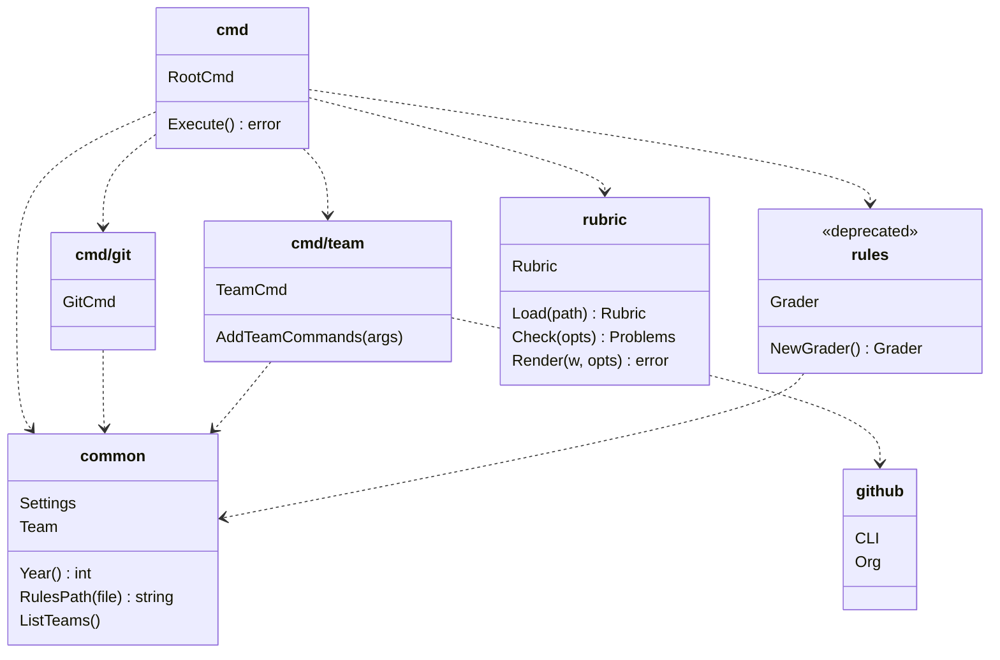

# Contributing

## Packages

The commands of `mc` are in the package `cmd`, and the work is done in the packages below it. The
diagram shows each package with its main types and functions, and an arrow from a package to each
package that it imports:

- `cmd` wires the commands with Cobra: `Execute()` checks the settings, adds the commands of the
  teams, then runs the command. It adds the subcommands of `cmd/git` (`mc git clone`, `pull`,
  `show`, `exec`) and of `cmd/team` (`mc team ls`, `mc team <team> provision`, etc.).
- `common` holds what every command shares: the settings of `~/.mc/settings.yaml`, the year, the
  team registry and the paths of the clones. It imports no package of `mc`.
- `github` runs the CLI `gh` on the organization: the repositories, the teams and their members.
  Only `cmd/team` changes GitHub.
- `rubric` reads the YAML of the evaluation rules, checks it and renders its page. It imports no
  package of `mc`: its tests only need the made-up file of `rubric/testdata/`.
- `rules` is the grading engine of 2025, which `mc grade` runs. It is deprecated.

The package `e2e` is not in the diagram: it builds the binary `mc` and runs it, with a made-up
`~/.mc` and a fake `gh`, so it imports no package.
