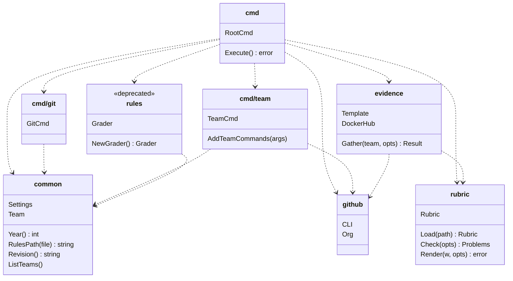

# Contributing

## Packages

The commands of `mc` are in the package `cmd`, and the work is done in the packages below it. The
diagram shows each package with its main types and functions, and an arrow from a package to each
package that it imports:

What each package does, in the order of the diagram:

| Package | What it does |
|---|---|
| `cmd` | Wires the commands with Cobra: `Execute()` checks the settings, adds the commands of the teams, then runs the command. |
| `cmd/git` | The commands on the clones of the teams: `mc git clone`, `pull`, `show` and `exec`. |
| `cmd/team` | The commands on the teams: `mc team ls`, `mc team <team> provision`, etc. The only package that changes GitHub. |
| `evidence` | Gathers the evidence of a lab for a team: the rules of the lab from `rubric`, the pushes from `github`, the files of the clone with `git`, and the tags on Docker Hub. It takes the rules and the team as arguments, so it doesn't import `common`. |
| `rules` | The grading engine of 2025, which `mc grade` runs. Deprecated. |
| `common` | What every command shares: the settings of `~/.mc/settings.yaml`, the year, the commit of `mc` that runs, the team registry and the paths of the clones. It imports no package of `mc`. |
| `github` | Runs the CLI `gh` on the organization: the repositories, the teams and their members, and the pushes to `main`. |
| `rubric` | Reads the YAML of the evaluation rules, checks it and renders its page. It imports no package of `mc`: its tests only need the made-up file of `rubric/testdata/`. |
| `e2e` | Builds the binary `mc` and runs it, with a made-up `~/.mc` and a fake `gh`. It imports no package, so the diagram leaves it out. |
