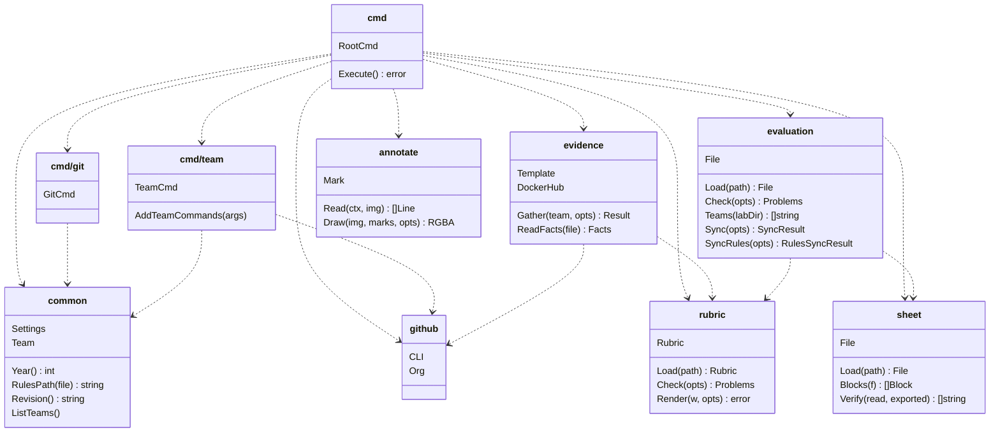

# Contributing

## Commands

A command of `mc` is a resource type, in the singular, then an action: `mc rule ls`, `mc team ls`,
`mc eval sync`. The teacher dictates the commands at times, so a name that follows one pattern is
easier to guess, and to say. There is no alias, such as `mc rules` for `mc rule`: an alias is a
second name to remember, and it hides the pattern.

`mc eval gather-facts` is the one exception: `gather` alone doesn't say what it gathers, and
`facts` alone is a noun where the action goes. The name says what the command does, which matters
more here.

`mc --help` lists the commands in 2 groups: the commands of the teacher, who runs them by hand,
and the commands of the agents, which the skills run for the evaluation, such as the boxes on a
screenshot or the cells of the spreadsheet. The teacher finds the commands to type at once, and a
command of the agents doesn't need a name that the teacher can say.

## Packages

The commands of `mc` are in the package `cmd`, and the work is done in the packages below it. The
diagram shows each package with its main types and functions, and an arrow from a package to each
package that it imports:

What each package does, in the order of the diagram:

| Package | What it does |
|---|---|
| `cmd` | Wires the commands with Cobra: `Execute()` checks the settings, adds the commands of the teams, then runs the command. |
| `cmd/git` | The commands on the clones of the teams: `mc git clone`, `pull`, `show` and `exec`. |
| `cmd/team` | The commands on the teams: `mc team ls`, `mc team <team> provision`, etc. The only package that changes GitHub. |
| `evidence` | Gathers the facts of a lab for a team: the rules of the lab from `rubric`, the pushes from `github`, the files of the clone with `git`, the evidence that the evaluator made, and the tags on Docker Hub. It takes the rules and the team as arguments, so it doesn't import `common`. |
| `evaluation` | Reads the evaluation of a lab for a team, one YAML file per team and lab, as the evaluator writes it. It checks it against the rules of `rubric`, and against the commit of the facts of `mc eval gather-facts`, which `cmd` reads and passes to it. It computes the cells that write the evaluations of a lab in the tab Evaluation, and the rules of the year in the tab Rules, as files of `sheet`. |
| `annotate` | Finds a text in a screenshot with `tesseract`, and draws numbered boxes around what the evaluator found. It imports no package of `mc`. |
| `sheet` | Keeps the data of a tab of the evaluation spreadsheet in JSON files, one object per row: the blocks of cells to paste, the script that reads the tab in a browser, and the check of the tab against the last export. It imports no package of `mc`. |
| `common` | What every command shares: the settings of `~/.mc/settings.yaml`, the year, the commit of `mc` that runs, the team registry and the paths of the clones. It imports no package of `mc`. |
| `github` | Runs the CLI `gh` on the organization: the repositories, the teams and their members, and the pushes to `main`. |
| `rubric` | Reads the YAML of the evaluation rules, checks it and renders its page. It imports no package of `mc`: its tests only need the made-up file of `rubric/testdata/`. |
| `e2e` | Builds the binary `mc` and runs it, with a made-up `~/.mc` and a fake `gh`. It imports `cmd` only so that `go test` runs again when the sources change, so the diagram leaves it out. |

A package can explain itself further in a `README.md` of its own: what it is for, and a diagram of
how it relates to the rest, such as the files that it reads and writes. A reader learns the package
there before the code, so the README changes with the package, in the same pull request.
