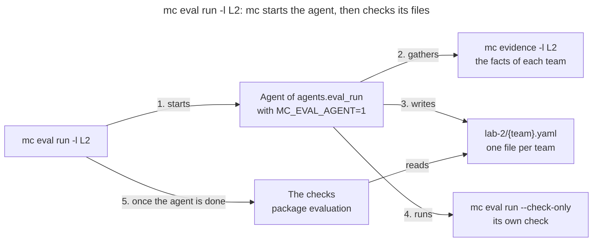

# Package `cmd`

The package `cmd` wires the commands of `mc` with [Cobra](https://github.com/spf13/cobra). A command
reads its flags and the settings, calls the package that does the work, and prints the result. The
work itself lives in the other packages, such as `evidence`, which gathers the evidence of a lab,
or `evaluation`, which checks an evaluation: `cmd` is the only package that knows the command line.
The [README](../README.md) describes the commands; this page explains how the package is organized.

## How a Command Runs

`main.go` calls `cmd.Execute`, which does 3 things before Cobra parses the command line:

1. `common.CheckSettings` reads `~/.mc/settings.yaml`. A broken file stops every command, so that
   no command runs on a year that the file failed to give.
2. `teamFileFromArgs` reads the flag `--team-file` ahead, since the next step needs the registry.
3. `team.AddTeamCommands` adds one command per team of the registry, such as `mc team red`.

Then Cobra runs the `RunE` of the command. A `RunE` returns its error rather than exiting: Cobra
prints it, and `main.go` exits with 1. The commands that can fail on their input, such as
`mc eval run`, set `SilenceUsage: true`, so that an error prints one line, not the usage.

## One File per Command

Each command has its own file, with its subcommands, their flags and their `RunE`:

| File | Commands | Packages that do the work |
|---|---|---|
| `eval.go` | `mc eval ls`, `mc eval run` | `evaluation`, `rubric`, and `evidence` for the facts |
| `eval_sync.go` | `mc eval sync` | `evaluation`, `sheet` |
| `evidence.go` | `mc evidence` | `evidence`, `rubric`, `github` |
| `rule.go` | `mc rule ls`, `check`, `render` | `rubric` |
| `sheet.go` | `mc sheet snippet`, `blocks`, `copy`, `pasted`, `verify` | `sheet` |
| `annotate.go` | `mc annotate find`, `draw` | `annotate` |
| `info.go` | `mc info` | `common` |
| `k8s.go` | `mc k8s create-namespaces` | `common` |
| `grade.go` | `mc grade`, deprecated | `rules` |
| `git/` | `mc git clone`, `pull`, `show`, `exec` | `common` |
| `team/` | `mc team ls`, `mc team {team} provision`, `status`, `validate` | `common`, `github` |

Every command but `annotate` reads `common`, for the year, the settings or the team registry.

## A Command That Starts an Agent

`mc eval run` is the first command that starts an AI agent: `mc` orchestrates, and the agent does
the work of a skill. The command line of the agent is the key `agents.eval_run` of the settings,
such as `claude -p "/evaluate-lab {lab} {teams}"`. Here is what happens for Lab 2:

1. `mc eval run` replaces `{lab}` and `{teams}` in the line, then runs it with `sh`, in the Git
   repository of the rules. A team goes into the line as it is, so its name must be lowercase
   letters, digits and dashes.
2. The agent gathers the facts of the teams with `mc evidence`.
3. It writes the evaluation of each team, one YAML file per team.
4. It checks its own files with `mc eval run --check-only`. Without `--check-only`, `mc eval run`
   refuses to run while `MC_EVAL_AGENT` is set, so that an agent never starts another one.
5. Once the agent is done, `mc eval run` checks the files itself, and exits with 1 on a problem. If
   the agent fails, its files are not checked.

The steps 2 to 4 are the work of the skill, not of `mc`: another agent could do them differently.

## Tests

`root_test.go` tests the flag `--team-file` read ahead, and `team/` has its own unit tests. The
other commands are tested end to end, in the package [`e2e`](../e2e/README.md), which runs the
binary of `mc`.
