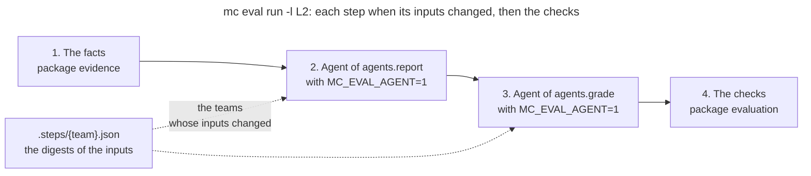

# Package `cmd`

The package `cmd` wires the commands of `mc` with [Cobra](https://github.com/spf13/cobra). A command
reads its flags and the settings, calls the package that does the work, and prints the result. The
work itself lives in the other packages, such as `evidence`, which gathers the facts of a lab, or
`evaluation`, which checks an evaluation: `cmd` is the only package that knows the command line.
The [README](../README.md) describes the commands; this page explains how the package is organized.

## How a Command Runs

`main.go` calls `cmd.Execute`, which does 3 things before Cobra parses the command line:

1. `common.CheckSettings` reads `~/.mc/settings.yaml`. A broken file stops every command, so that
   no command runs on a year that the file failed to give.
2. `teamFileFromArgs` reads the flag `--team-file` ahead, since the next step needs the registry.
3. `team.AddTeamCommands` adds one command per team of the registry, such as `mc team red`.

Then Cobra runs the `RunE` of the command. A `RunE` returns its error rather than exiting: Cobra
prints it, and `main.go` exits with 1. The commands that can fail on their input, such as
`mc eval run`, set `SilenceUsage: true`, so that an error prints one line, not the usage.

## One File per Command

Each command has its own file, with its subcommands, their flags and their `RunE`:

| File | Commands | Packages that do the work |
|---|---|---|
| `eval.go` | `mc eval ls`, and the checks of the evaluations | `evaluation`, `rubric`, and `evidence` for the facts |
| `eval_run.go` | `mc eval run`: its steps, their agents and their record | `evaluation`, `evidence`, `rubric` |
| `eval_gather_facts.go` | `mc eval gather-facts` | `evidence`, `rubric`, `github` |
| `eval_sync.go` | `mc eval sync` | `evaluation`, `sheet` |
| `rule.go` | `mc rule ls`, `check`, `render` | `rubric` |
| `rule_sync.go` | `mc rule sync` | `evaluation`, `rubric`, `sheet` |
| `sheet.go` | `mc sheet snippet`, `blocks`, `copy`, `pasted`, `verify` | `sheet` |
| `annotate.go` | `mc annotate find`, `draw` | `annotate` |
| `info.go` | `mc info` | `common` |
| `k8s.go` | `mc k8s create-namespaces` | `common` |
| `git/` | `mc git clone`, `pull`, `show`, `exec` | `common` |
| `team/` | `mc team ls`, `mc team {team} provision`, `status`, `validate` | `common`, `github` |

Every command but `annotate` reads `common`, for the year, the settings or the team registry.

## A Command That Starts Agents

`mc eval run` is the command that starts AI agents: `mc` orchestrates, and each agent does the
work of a skill. The agents are the keys `agents.report` and `agents.grade` of the settings, such
as `claude -p "/report-lab {lab} {teams}"`, with the files that they read, their `inputs`. Here is
what happens for Lab 2:

1. `mc eval run` gathers the facts of each team with the package `evidence`, as
   `mc eval gather-facts` does.
2. For each team, it compares the digests of the inputs of the report with those of
   `.steps/{team}.json`, the record of the last run that succeeded. It replaces `{lab}`, `{teams}`
   and `{late}` in the line of the agent, `{teams}` with the teams whose inputs changed, then runs
   it with `sh`, in the Git repository of the rules. A team goes into the line as it is, so its
   name must be lowercase letters, digits and dashes. Once the agent is done, each team whose
   report is at the commit of the facts gets its record, and the others stop.
3. The same for the grades, whose inputs add the report and the rules of the lab.
4. `mc eval run` checks the evaluations, then records the grades of the teams whose file has no
   problem. It exits with 1 if a team stopped, or if a file has a problem.

The agents run with `MC_EVAL_AGENT` set: without `--check-only`, `mc eval run` refuses to run
then, so that an agent never starts another one. What an agent does, such as gathering the facts
again once it adds its evidence, is the work of its skill, not of `mc`: another agent could do it
differently.

## Tests

`root_test.go` tests the flag `--team-file` read ahead, and `team/` has its own unit tests. The
other commands are tested end to end, in the package [`e2e`](../e2e/README.md), which runs the
binary of `mc`.
