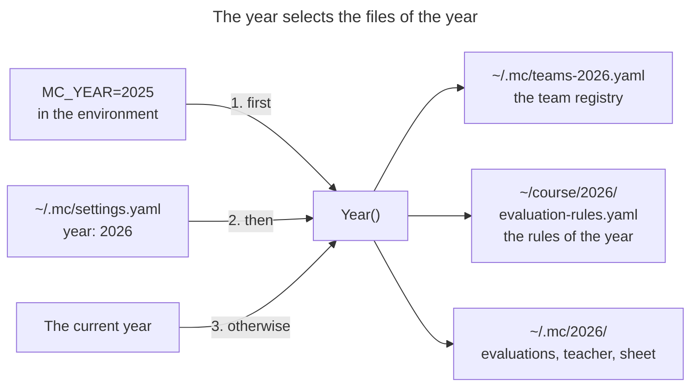

# Package `common`

The package `common` holds what the commands of `mc` share: the settings of the machine, the year
of the cohort, the team registry of the year, and the commit of `mc` that runs. The settings and
the registry are private files of `~/.mc`, which never go to Git: the registry holds the names of
the students.

## The Year Selects the Files

Most files of `mc` belong to a year: the team registry, the evaluation rules, and the files that
the commands write, such as the evaluations. `Year` gives the year, from 3 sources in order:



1. **The variable `MC_YEAR`**, to look at a former year once, such as `MC_YEAR=2025 mc team ls`.
   The end-to-end tests set it too, so that they don't depend on the clock.
2. **The key `year` of the settings**, the cohort that the machine works on.
3. **The current year**, without settings.

`TeamRegistryPath` gives `~/.mc/teams-{year}.yaml`, or the file of the flag `--team-file`, such as a
test registry. `RulesPath` gives the file of the flag `--rules-file`, or the key `rules` of the
settings with `{year}` replaced, such as `~/course/{year}/evaluation-rules.yaml`. The directories
of the year, `~/.mc/{year}/`, are built by `cmd` from `ConfigDir` and `Year`.

## The Settings

`~/.mc/settings.yaml` is optional, and so is each of its keys:

```yaml
year: 2026
rules: ~/course/{year}/evaluation-rules.yaml
agents:
  eval_run: claude -p "/evaluate-lab {lab} {teams}"
```

An unknown key is an error, so that a typo doesn't go unnoticed, and `CheckSettings` runs before
every command. `CurrentSettings` reads the file once per run. The key `agents` holds the command
lines of the AI agents that `mc` starts, such as the one of `mc eval run`.

## The Team Registry

`LoadRegistry` reads the registry of the year: its students, its teams and the URL of the
evaluation spreadsheet. An unknown top-level key is an error, for the same reason as in the
settings. `ListTeams` and `FilterTeams` give its teams, and `AddTeam` and `SetTeamMembers` change
it while keeping its comments, for `mc team {team} provision`. A `Team` knows its repository, such
as `k8s-red`, and its clone, such as `~/github/mincong-classroom/k8s-red`.

`ParseName` and `SameName` read the names of the students in the format "LAST First", for
`mc team ls`, `provision` and `validate`.

## The Commit of `mc`

`Revision` returns the commit of `mc` that runs, from the build information of Go, such as
`8e39f42dfb73`, with `-dirty` for a local build with uncommitted changes. `mc evidence` writes it in
the front matter of its facts, and gathers the facts again when it changes. `StableRevision` tells
a commit without local changes, or a tag, whose two runs run the same code.

## Code

The files of the package:

| File | What it holds |
|---|---|
| `settings.go` | `Settings` and `Agents`, `CheckSettings`, `Year`, `RulesPath` and `ExpandHome` |
| `team.go` | `ConfigDir`, the team registry: `LoadRegistry`, `ListTeams`, `AddTeam`, `SetTeamMembers` |
| `types.go` | `TeamRegistry`, `Team` and `Student`; the types of `mc grade`, deprecated |
| `name.go` | `ParseName` and `SameName`, the names of the students |
| `revision.go` | `Revision` and `StableRevision`, the commit of `mc` |

The tests use made-up teams and names only.
