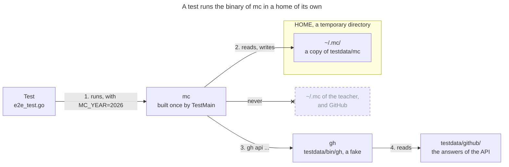

# Package `e2e`

The package `e2e` tests `mc` end to end: it builds the binary, runs it as the teacher would, and
checks what it prints, its exit code, and the files that it writes. The tests of the other packages
call functions; these tests catch what only a run shows, such as a flag that Cobra parses
differently, or the settings that `mc` checks before every command.

## A Home of Its Own

`mc` reads and writes the private files of `~/.mc`, and changes GitHub through the `gh` CLI. A test
must touch neither: it runs the binary in a home of its own, with a fake `gh`:

1. **The binary.** `TestMain` builds `mc` once, with `go build`, then each test runs it with
   `env.run`. `MC_YEAR=2026` makes the year independent of the clock.
2. **The home.** `newEnv` creates a temporary `HOME`, whose `~/.mc` is a copy of `testdata/mc`:
   the team registry of 2026, with made-up teams and names. A test adds its own files with
   `env.writeFile`, such as the settings, the rules or the evaluations of `writeEvaluations`.
3. **The fake `gh`.** `testdata/bin/gh` comes first in the `PATH` of `mc`. It answers `gh api` with
   the files of `testdata/github`, or with a 404 like GitHub.
4. **The changes.** A change, such as `gh repo create`, changes nothing: the fake `gh` writes it to
   a log, and `env.ghChanges` returns it, so that a test checks which changes `mc` asked for.

The clones of the teams are Git repositories that a test creates in its home, with `initTeamRepo`
or `cloneRedRepo`: `mc git` reads them as it reads the real ones. The facts of
`mc eval gather-facts` are written by hand, as `writeEvaluations` does: the package `evidence` has
its own tests of a pass.

## The Cache of `go test`

`go test` caches the result of a package, and runs it again when a file that the test opened
changes. Here, `mc` and the fake `gh` open the files, not the test. So the package imports `cmd`,
and reads every file of `testdata` once: a change of the sources or of a fixture runs the tests
again.

## Code

The files of the package:

| File | What it holds |
|---|---|
| `e2e_test.go` | `TestMain`, the home of a test (`env`), its helpers, and the tests of the commands |
| `sheet_test.go` | The tests of `mc sheet`: a paste, then a check of the tab |
| `testdata/mc/` | The team registry of the tests, with made-up teams and names |
| `testdata/test-teams-2026.yaml` | Another registry, for the flag `--team-file` |
| `testdata/bin/gh` | The fake `gh`, a shell script |
| `testdata/github/` | The answers of the API of GitHub, one JSON file per path |

Run them with `go test ./e2e/`. `mc` is public: a test uses made-up teams and names only, never a
real one.
