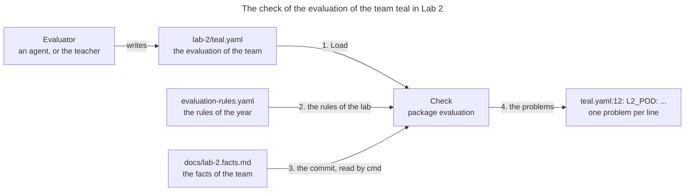
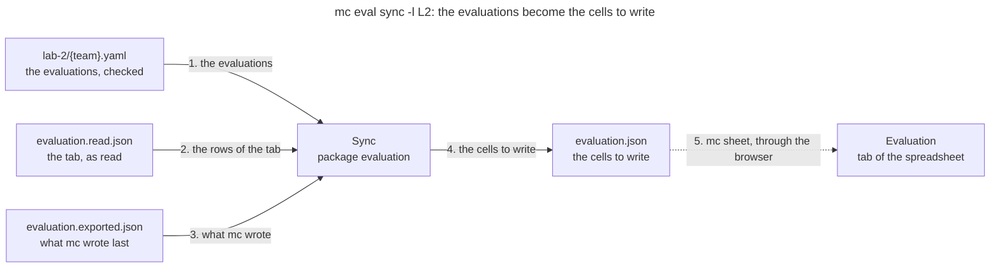

# Package `evaluation`

The package `evaluation` reads the evaluation of a lab for a team, as the evaluator writes it, and
checks it against the evaluation rules. The evaluator is an AI agent that `mc eval run` starts, or
the teacher. The checks catch its mistakes before the evaluation goes any further: a rule
forgotten, a completeness of 0.85, a penalty that the rules don't give, or another commit than the
one of the facts. Then the package computes the cells that write the evaluations in the evaluation
spreadsheet, and those that write the rules of the year. The commands are `mc eval ls`,
`mc eval run` and `mc eval sync`, described in the section [Evaluation](../README.md#evaluation)
of the README, and `mc rule sync`, in the section [Rule](../README.md#rule): this page explains the
package behind them.

## One File per Team and Lab

Each team has one YAML file per lab, so that several evaluators can work at once, each on its own
teams: `~/.mc/{year}/evaluations/lab-{n}/{team}.yaml`. Here is the file of the made-up team teal in
Lab 2, with one rule:

```yaml
team: teal
commit: 0a1b2c3
time_spent: Session only, done at 11:21
action_items: Run it yourself
rules:
  L2_POD:
    completeness: 0.8
    done_well: The Pod runs the image of Lab 1.
    to_improve: The report doesn't show the logs of the Pod.
    to_check: ""
    analysis: short
    writing_style: own words
    penalty: null
```

`LabDir`, `Path` and `Teams` give the directory of a lab, the file of a team, and the teams that
have a file.

## What a Check Reads

A check compares the file with 2 other sources: the rules of the year, and the facts that
`mc eval gather-facts` gathered for the team, which give the commit to evaluate:



1. **The file.** `Load` reads it with the known keys only: an unknown key, a key twice or a value
   of the wrong type is a problem. It keeps the line of each key, from the `yaml.Node` of the file,
   so that every problem says where to look.
2. **The rules.** A `rubric.Rubric` gives the rules of the lab, the mandatory ones, the analysis
   levels, and the penalties with the share of the score they remove.
3. **The commit of the facts.** It is in the front matter of the facts, in the worktree of the
   team. The package doesn't read it: `cmd` does, with `evidence.ReadFacts`, and passes it in
   `CheckOptions`. This way, `evaluation` doesn't import `evidence`.
4. **The problems.** `Check` returns them in the order of their lines, and `mc eval run` prints them
   as `teal.yaml:12: L2_POD: message`, then exits with 1.

## The Checks

Besides the keys, `Check` looks at:

- the team, which is the name of the file
- the commit: a hash of at least 7 hexadecimal digits, which starts the commit of the facts. No
  facts at all is a problem too: gather them first
- the action items, if any: "Run it yourself", "Talk with them", "Less attention" or "Late work to
  decide"
- the rules: each mandatory rule of the lab, an optional one if evaluated, and no rule of another
  lab
- each rule: a completeness from 0 to 1 by steps of 0.1, `done_well`, `to_improve`, an analysis
  among the analysis levels of the rules, and a writing style
- a penalty: its kind, the share of the score that the rules give for it, and why. The kind is a
  penalty of every rule, such as `secret`, or `rule` for the penalty of the rule itself, or `late`,
  whose share goes from the min to the max of the late penalty

## From the Evaluations to the Sheet

`Sync` turns the evaluations of a lab into the cells of the tab Evaluation of the evaluation
spreadsheet. It writes nothing in the spreadsheet: it computes the file of the package `sheet` that
waits to be pasted, from 3 inputs:



1. **The evaluations** of the lab, which `mc eval sync` checks first, as `mc eval run` does.
2. **The tab, as read** after the last paste. A row is found by its team, its lab and its rule. A
   missing row is new: it goes after the last row of the tab, with its keys and the formulas of
   Rule Score, Score and TA Lab Flag.
3. **What `mc` wrote last.** A cell of the tab that differs from it was changed by someone else,
   such as the teacher: the sync never overwrites it without a `_check`.
4. **The cells to write**, in `evaluation.json`. The rows of the lab and the teams that waited there
   are replaced, and the others wait still.
5. **The paste**, with the commands of `mc sheet`: see [its README](../sheet/README.md).

The rules of a pass decide each cell:

- The completeness goes to an empty cell, or over the one that `mc` wrote last when it is higher.
  A lower one keeps the former value, and so does a completeness that `mc` didn't write: TA To
  Check says why.
- The other TA columns follow the evaluation, but a cell is never cleared.
- TA Comment says "Done well: ... To improve: ...", and the reason of a penalty, if any. The
  penalty itself becomes the formula of TA Penalty, such as `=-0.1*G80*F80`.
- A text that starts with `=` is an error, since Sheets would read it as a formula.

## From the Rules to the Sheet

`SyncRules` turns the rules of the YAML into the cells of the tab Rules, where the Rule Score of
the tab Evaluation looks up the score of each rule. It works as `Sync`, from the tab as read and
what `mc` wrote last, and computes `rules.json`. Here are the columns of the tab, with the rules
`L1_BLD` and `L2_LOG` of the made-up file of the tests,
[`rubric/testdata/evaluation-rules.yaml`](../rubric/testdata/evaluation-rules.yaml), as examples:

| Column | Header | What it holds | Examples |
|---|---|---|---|
| A | Lab Session | The lab of the rule, the key `lab` of the YAML. With the Rule, it finds the row of a rule | `L1`, `L2` |
| B | Rule | The end of the Rule ID, after the lab and the underscore. With the Lab Session, it finds the row of a rule | `BLD`, `LOG` |
| C | Rule ID | The ID of the rule, a formula that joins A and B, `=CONCAT(A2, CONCAT("_", B2))`. The Rule Score of the tab Evaluation looks it up | `L1_BLD`, `L2_LOG` |
| D | Rule Name | The name of the rule, the key `name` of the YAML | `Build Test`, `Logs Test` |
| E | Coefficient | The share of the 20 points of the lab that the rule gives, the key `coefficient` of the YAML. A bonus, such as `L2_LOG`, counts on top of the 20 points | `0.6`, `0.1` |
| F | Score | The points of the rule, a formula, `=20*E2` | `12`, `2` |
| G | Exercise | The exercise of the rule, the key `exercise` of the YAML, as a number | `1`, `2.1` for the part 2.1 of Exercise 2 |
| H | Exercise ID | The ID of the exercise, a formula that joins A and G, `=CONCAT(CONCAT(A2, "_"), CONCAT("EX", G2))` | `L1_EX1`, `L2_EX2.1` |
| I | Rule Description | What the team is expected to deliver, the key `description` of the YAML, on one line | "The team is expected to follow the logs of the Pod. This rule is a bonus." |

The column J, Troubleshooting Instructions, belongs to the teacher: `mc` never reads it.

- A row is found by A and B, whose values the YAML gives, rather than by C, which is a formula. A
  rule that the tab doesn't have gets a new row after the last one, with the formulas of C, F and H.
- D, E, G and I follow the YAML. A cell that `mc` didn't write, such as a coefficient tuned in the
  tab, gets a `_check`, and waits in a block to check first.
- A formula whose value is not the one that it gives from its row, such as a Rule ID typed over it,
  is written again with a `_check`.
- A row whose rule the YAML no longer has is listed in the result, `Extra`, and never deleted.

## Code

The files of the package:

| File | What it holds |
|---|---|
| `evaluation.go` | `File`, `Rule` and `Penalty`; `Load`, with the line of each key; `LabDir`, `Path` and `Teams` |
| `check.go` | `Check` and `CheckOptions`: the problems of a file against the rules and the commit of the facts |
| `sync.go` | `Sync`, its options and its result: the cells of the tab Evaluation, and `SheetFile`, its columns |
| `rules.go` | `SyncRules`, its options and its result: the cells of the tab Rules, and `RulesSheetFile`, its columns |

The package imports `rubric` and `sheet` only, and its tests use made-up teams and rules.
