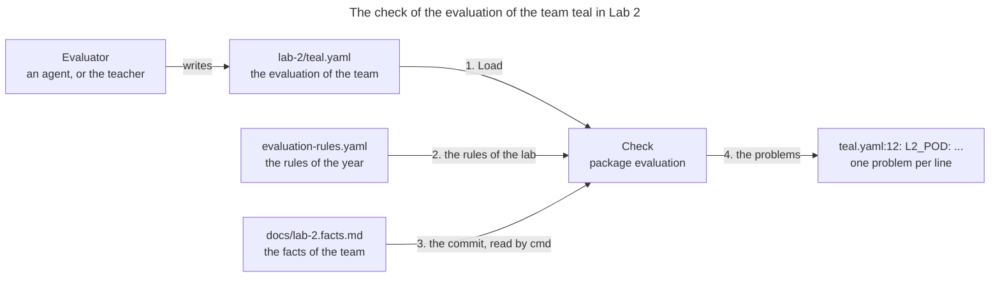
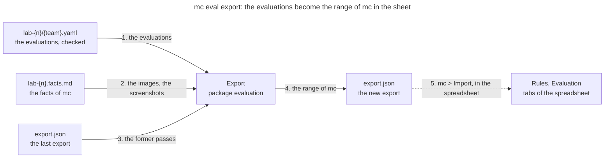

# Package `evaluation`

The package `evaluation` reads the evaluation of a lab for a team, as the evaluator writes it, and
checks it against the evaluation rules. The evaluator is an AI agent that `mc eval run` starts, or
the teacher. The checks catch its mistakes before the evaluation goes any further: a rule
forgotten, a completeness of 0.85, a penalty that the rules don't give, or another commit than the
one of the facts. Then the package computes the export of the evaluation spreadsheet: the rules
of the year in the tab Rules, and the evaluations in the tab Evaluation. The commands are
`mc eval ls`, `mc eval run` and `mc eval export`, described in the section
[Evaluation](../README.md#evaluation) of the README: this page explains the package behind them.

## One File per Team and Lab

Each team has one YAML file per lab, so that several evaluators can work at once, each on its own
teams: `~/.mc/{year}/evaluations/lab-{n}/{team}.yaml`. Here is the file of the made-up team teal in
Lab 2, with one rule:

```yaml
team: teal
commit: 0a1b2c3
time_spent: Session only, done at 11:21
action_items: Run it yourself
rules:
  L2_POD:
    completeness: 0.8
    done_well: The Pod runs the image of Lab 1.
    to_improve: The report doesn't show the logs of the Pod.
    to_check: ""
    analysis: short
    writing_style: own words
    penalty: null
```

`LabDir`, `Path` and `Teams` give the directory of a lab, the file of a team, and the teams that
have a file.

## What a Check Reads

A check compares the file with 2 other sources: the rules of the year, and the facts that
`mc eval gather-facts` gathered for the team, which give the commit to evaluate:



1. **The file.** `Load` reads it with the known keys only: an unknown key, a key twice or a value
   of the wrong type is a problem. It keeps the line of each key, from the `yaml.Node` of the file,
   so that every problem says where to look.
2. **The rules.** A `rubric.Rubric` gives the rules of the lab, the mandatory ones, the analysis
   levels, and the penalties with the share of the score they remove.
3. **The commit of the facts.** It is in the front matter of the facts, in the worktree of the
   team. The package doesn't read it: `cmd` does, with `evidence.ReadFacts`, and passes it in
   `CheckOptions`. This way, `evaluation` doesn't import `evidence`.
4. **The problems.** `Check` returns them in the order of their lines, and `mc eval run` prints them
   as `teal.yaml:12: L2_POD: message`, then exits with 1.

## The Checks

Besides the keys, `Check` looks at:

- the team, which is the name of the file
- the commit: a hash of at least 7 hexadecimal digits, which starts the commit of the facts. No
  facts at all is a problem too: gather them first
- the action items, if any: "Run it yourself", "Talk with them", "Less attention" or "Late work to
  decide"
- the rules: each mandatory rule of the lab, an optional one if evaluated, and no rule of another
  lab
- each rule: a completeness from 0 to 1 by steps of 0.1, `done_well`, `to_improve`, an analysis
  among the analysis levels of the rules, and a writing style
- a penalty: its kind, the share of the score that the rules give for it, and why. The kind is a
  penalty of every rule, such as `secret`, or `rule` for the penalty of the rule itself, or `late`,
  whose share goes from the min to the max of the late penalty

## From the Evaluations to the Sheet

`Export` computes the export of the evaluation spreadsheet, a `sheet.Export`: the range of `mc` in
the tab Rules and in the tab Evaluation, every row of it. It writes nothing in the spreadsheet: the
script of `mc sheet script` imports the export, see [the README of `sheet`](../sheet/README.md).
It starts from 3 inputs:



1. **The evaluations** of the labs, which `mc eval export` checks first, as `mc eval run` does.
2. **The facts** of `mc eval gather-facts`, which `cmd` reads and passes in
   `LabEvaluations.Facts`: the tags of the images of each rule, and the number of screenshots of
   the team.
3. **The last export.** Its rows are the former passes: a row is found by its team, its lab and its
   rule. A tab of another layout is an error, since its cells would land in other columns: migrate
   it first.
4. **The new export**, which holds the rows of the last one, with the rows of the evaluations
   computed again. The rows of the labs and the teams that the options don't give stay as they
   are.
5. **The import**, with the script of the spreadsheet.

The evaluation replaces the cells of `mc` on its row:

- A row that the last export doesn't have is added after the last row.
- Every TA column follows the evaluation: the "TA Completeness", even when it is lower than in the
  last export, with its "TA Comment". A text that the evaluation leaves empty clears its cell.
- "TA Docker Images" and "TA Screenshots" follow the facts the same way: a rule without images
  clears "TA Docker Images". Without facts for the rule, both stay as in the last export.
- "TA Comment" says "Done well: ... To improve: ...", and the reason of a penalty, if any. The
  penalty itself becomes the formula of "TA Penalty", such as
  `=-0.1*IF(ISBLANK(H{row}),G{row},H{row})*F{row}`. Without a penalty, "TA Penalty" is cleared.
- A text that starts with `=` is an error, since Sheets would read it as a formula.

The tab Evaluation gives H as its confirmed column (`sheet.Tab.Confirmed`): a filled H means that
the teacher confirmed the evaluation of the rule, so the script of the spreadsheet never writes
that row. The export still computes it: `mc` can't read H, and the summary of the import lists the
cells of a confirmed row that differ from the export.

`ExportResult` gives what changed since the last export, cell by cell, the new rows, and the rules
of the last export that the YAML no longer has, for the output of `mc eval export`. `Change.Lower`
tells a "TA Completeness" that went down, which the output marks and counts.

Here are the columns of the tab Evaluation. The range of `mc` is A, D to G, I, and L to V:

| Column | Header | What it holds |
|---|---|---|
| A | Team | The team, a key |
| B, C | The students | Formulas of the teacher, which find the students of the team: a new row copies them from the row above, and `mc` never reads them |
| D | Lab | The lab, a key |
| E | Rule | The ID of the rule, a key |
| F | Rule Score | The points of the rule, a formula that looks up the tab Rules, `=VLOOKUP(E2,Rules!C:F,4,FALSE)` |
| G | TA Completeness | The completeness of the evaluation, from 0 to 1 |
| H | Completeness | The completeness of the teacher, which `mc` never writes: once filled, the "Score" takes it instead of G, and the evaluation of the rule is confirmed by the teacher, final, so the import never writes the row. Empty, the evaluation is not confirmed yet |
| I | Score | A formula, `=IF(ISBLANK(H2),G2,H2)*F2+T2` |
| J, K | Comment, Troubleshooting Instructions | The teacher's |
| L to R | TA To Check, TA Commit, TA Docker Images, TA Screenshots, TA Analysis, TA Writing Style, TA Time Spent | The evaluation and the facts |
| S | TA Lab Flag | A formula, which flags a lab below 12 of 20 points |
| T | TA Penalty | The formula of a penalty, if any |
| U, V | TA Action Items, TA Comment | The evaluation |

## From the Rules to the Sheet

The tab Rules of the export holds the rules of the YAML, where the "Rule Score" of the tab
Evaluation looks up the score of each rule. Here are its columns, with the rules `L1_BLD` and
`L2_LOG` of the made-up file of the tests,
[`rubric/testdata/evaluation-rules.yaml`](../rubric/testdata/evaluation-rules.yaml), as examples:

| Column | Header | What it holds | Examples |
|---|---|---|---|
| A | Lab Session | The lab of the rule, the key `lab` of the YAML. With the "Rule", it finds the row of a rule | `L1`, `L2` |
| B | Rule | The end of the "Rule ID", after the lab and the underscore. With the "Lab Session", it finds the row of a rule | `BLD`, `LOG` |
| C | Rule ID | The ID of the rule, a formula that joins A and B, `=CONCAT(A2, CONCAT("_", B2))`. The "Rule Score" of the tab Evaluation looks it up | `L1_BLD`, `L2_LOG` |
| D | Rule Name | The name of the rule, the key `name` of the YAML | `Build Test`, `Logs Test` |
| E | Coefficient | The share of the 20 points of the lab that the rule gives, the key `coefficient` of the YAML. A bonus, such as `L2_LOG`, counts on top of the 20 points | `0.6`, `0.1` |
| F | Score | The points of the rule, a formula, `=20*E2` | `12`, `2` |
| G | Exercise | The exercise of the rule, the key `exercise` of the YAML, as a number | `1`, `2.1` for the part 2.1 of Exercise 2 |
| H | Exercise ID | The ID of the exercise, a formula that joins A and G, `=CONCAT(CONCAT(A2, "_"), CONCAT("EX", G2))` | `L1_EX1`, `L2_EX2.1` |
| I | Rule Description | What the team is expected to deliver, the key `description` of the YAML, on one line | "The team is expected to follow the logs of the Pod. This rule is a bonus." |

The column J, "Troubleshooting Instructions", belongs to the teacher: `mc` never writes it.

- A row is found by A and B, whose values the YAML gives, rather than by C, which is a formula. A
  rule that the last export doesn't have gets a new row after the last one.
- D, E, G and I follow the YAML, which is the source of truth: a coefficient tuned in the tab is
  written over at the next import, so tune it in the YAML.
- C, F and H are formulas, written on every row.
- A row whose rule the YAML no longer has is listed in the result, `Removed`, and never deleted:
  the import keeps its keys, and clears its other cells.

## The Record of the Steps

`mc eval run` runs a step for a team only when one of its inputs changed since the step last
succeeded. The record of the team, `lab-{n}/.steps/{team}.json`, holds the SHA-256 of each input,
and when the step was done:

```json
{
  "report": {
    "inputs": {
      "facts": "3a7bd3e2360a3d29eea436fcfb7e44c735d117c42d1c1835420b6b9942dd4f1b",
      "files": {".claude/skills/report-lab/SKILL.md": "9f86d081884c7d659a2feaa0c55ad015a3bf4f1b2b0b822cd15d6c15b0f00a08"}
    },
    "done": "2030-03-04T09:30:00+01:00"
  }
}
```

- `Digest` gives the facts, from their front matter without the commit of `mc`, which `cmd` reads.
- `DigestFile` gives the report, and `DigestFiles` the `inputs` of an agent: a file, or every file
  of a directory, without the hidden files, such as `.DS_Store`.
- `DigestRules` gives the rules of a lab, without their coefficients, and with what applies to
  every rule, such as the penalties of `scoring`.
- `Changes` says what changed since the record, such as "the facts changed", for the output of
  `mc eval run`.

The directory `.steps` starts with a dot, so `Teams` doesn't take it for a team. `WriteSteps`
writes a temporary file, then renames it, so that a run that stops never leaves half a record.

## Code

The files of the package:

| File | What it holds |
|---|---|
| `evaluation.go` | `File`, `Rule` and `Penalty`; `Load`, with the line of each key; `LabDir`, `Path` and `Teams` |
| `check.go` | `Check` and `CheckOptions`: the problems of a file against the rules and the commit of the facts |
| `export.go` | `Export`, its options and its result: the tabs of the export, the rules of a pass, and `EvaluationLayout`, the layout of the tab Evaluation |
| `rules.go` | The tab Rules of the export, and `RulesLayout`, its layout |
| `steps.go` | `Steps`, the record of the steps of `mc eval run` for a team, `ReadSteps` and `WriteSteps`; `Changes`, and the digests of the inputs |

The package imports `rubric` and `sheet` only, and its tests use made-up teams and rules.
