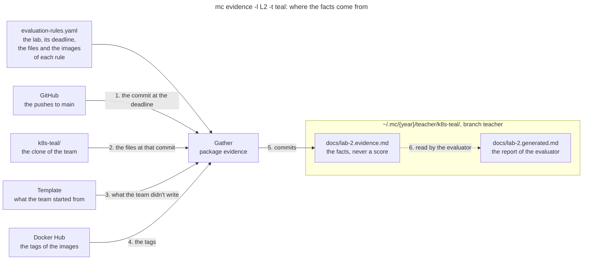

# Package `evidence`

The package `evidence` gathers the evidence of each rule of a lab for a team, in a report for the
teacher: the facts that an evaluation needs, never a score. The command is `mc evidence`, described
in the section [Evidence](../README.md#evidence) of the README, with the content of the report:
this page explains where the facts come from, and where the report goes.

## Where the Facts Come From

`Gather` reads 5 sources for a team, then commits the report to a branch of its own. Here is the
evidence of Lab 2 for the made-up team teal:

1. **The commit.** The pushes to `main`, from the activity of the repository on GitHub, give the
   head of `main` at the deadline of the lab. The dates of the commits are those of the machine of
   the team, so they only serve without the activity. A late pass takes `origin/main`
   instead, and `--rev` a commit given.
2. **The files of the team**, read from its clone at that commit, with `git`: the report of the
   lab, the files of each rule, and the files that the report links to. The clone is fetched, and
   its branches other than `teacher` are never changed.
3. **The template**, the repository that the team started from: its files tell the lines of the
   statement from those of the team. Without the flag `--template`, it is the first commit of the
   repository of the team.
4. **The tags on Docker Hub** of the images of each rule, with their platforms and their push
   dates.
5. **The report**, `docs/lab-2.evidence.md`, next to the report of the team, `docs/lab-2.md`. It is
   committed to the local branch `teacher`, checked out in a worktree: the branch starts from the
   commit evaluated, and the next pass merges the new commit into it. `mc` never pushes it.
6. **The report of the evaluator**, such as `docs/lab-2.generated.md`, which an agent writes from
   the facts. The package doesn't write it, but it reads its front matter, below.

## When a Team Is Skipped

The front matter of the report holds 2 commits: the commit of the team evaluated, and the commit of
`mc` that gathered the facts. The report of the evaluator copies it. When both commits of the
report of the evaluator are those of now, nothing changed since it was written: `Gather` skips the
team, and `Result.UpToDate` says so. A local build of `mc` with changes never skips a team, since
its commit doesn't tell which code ran.

`ReadFacts` reads the same front matter for another command: `mc eval run` checks that an
evaluation is about the commit of the facts.

## Code

The files of the package:

| File | What it holds |
|---|---|
| `evidence.go` | `Gather`, its `Options` and its `Result`; the choice of the commit |
| `git.go` | The commands of `git` on the clone, the worktree, and `Template` |
| `build.go` | The facts of each rule: the lines of the team, the files, the images |
| `write.go` | The Markdown of the report |
| `markdown.go` | The headings and the code blocks of the report of the team |
| `metadata.go` | The front matter: `ReadFacts` and `ReportPath` |
| `registry.go` | `DockerHub`, the tags of a repository of images |

GitHub and Docker Hub come in through the interfaces `Pushes` and `Registry`, so that the tests
replace them. The tests build their repositories with `git` in a temporary directory, with made-up
teams, and compare the report with `testdata/lab-1.evidence.md`.
