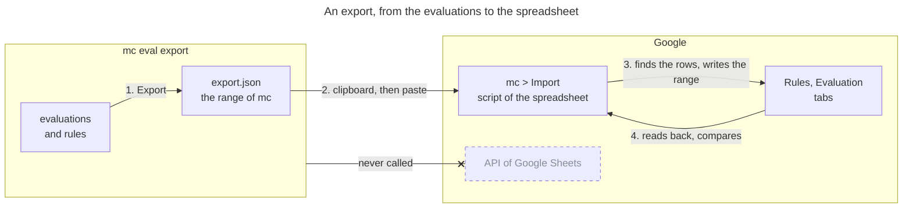

# Package `sheet`

The package `sheet` writes the data of `mc` in a Google Spreadsheet: the export, a JSON file with
the range of `mc` in each tab, and the script of the spreadsheet that imports it. `mc` uses it for
the evaluation spreadsheet of the year, whose tab Evaluation has one row per team, lab and rule.
The commands are `mc eval export` and `mc sheet script`, described in the section
[Sheet](../README.md#sheet) of the README: this page explains the package behind them.

## Why Not the API of Google Sheets

The package never calls the API of Google Sheets. The API needs a project of Google Cloud, an OAuth
client, and a token of the teacher's Google account kept on the machine, for one spreadsheet that
is written a few times per lab. A script bound to the spreadsheet needs none of it: it runs in
Google, as the teacher, who authorizes it once, for this spreadsheet only (`@OnlyCurrentDoc`). So
`mc` writes the export, and the teacher, or an agent in the browser such as Claude in Chrome,
pastes it in the dialog of the script. `mc` holds no credential of Google.

The script writes a tab with one call per group of adjacent columns, whatever the number of rows.
Before it, an agent pasted the cells in the page of the spreadsheet, block after block, which took
about 40 minutes for a tab of about 500 rows.

## How the Data Moves

Here are the steps of an import, from the evaluations to the tabs of the spreadsheet:



1. **Export.** `mc eval export` computes the range of `mc` in each tab, from the rules and the
   evaluations, against the last export. Then it saves it with `Save`, and copies it to the
   clipboard.
2. **Paste.** The menu "mc", then "Import", opens a dialog with a text box, where the export is
   pasted.
3. **Write.** The script reads the headers of each tab and its columns of keys, and stops before
   any write if a header is not at its letter. Then it finds the row of each key, adds the new rows
   at the end, and rewrites the range of `mc` on every row.
4. **Check.** The script reads the cells back and compares them with the export. Its summary gives
   the rows imported, the new ones, and each cell that differs.

The export is the whole range of `mc`, not the changes since the last one: an import that stops
halfway is fixed by the next import of the same file.

## An Export

An export holds one object per tab, whose rows hold one object each, like the documents of a
collection in MongoDB: each attribute is a column, named by its header. Here is a tab with a
made-up team, and some columns only:

```json
{
  "name": "Evaluation",
  "keys": ["Team", "Lab", "Rule"],
  "columns": {"A": "Team", "D": "Lab", "E": "Rule", "F": "Rule Score", "G": "TA Completeness", "T": "TA Penalty"},
  "formulas": {"Rule Score": "=VLOOKUP(E{row},Rules!C:F,4,FALSE)"},
  "fill": ["B", "C"],
  "rows": [
    {"Team": "teal", "Lab": "L2", "Rule": "L2_POD", "TA Completeness": 0.8,
     "TA Penalty": "=-0.1*IF(ISBLANK(H{row}),G{row},H{row})*F{row}"}
  ]
}
```

- `columns` gives the letter of each header: the range of `mc`. A column out of it is never
  written, and never read but for the keys.
- `keys` find a row. They are texts, never formulas.
- `formulas` gives the formula of a column on every row, where `{row}` is the number of the row. A
  row gives no cell of such a column.
- `fill` names the columns that a new row copies from the row above, such as the formulas that
  find the students of its team. They are out of `columns`.
- A cell of a row is a number, a text, or a formula of its own, such as a penalty. A cell not given
  becomes empty.

## What Keeps the Tab Safe

**The headers are checked before any write.** If a column was inserted or renamed, the import
stops with the header that differs, and writes nothing.

**The columns of the teacher are never written.** The script writes the columns of the export
only, and reads none of the others, the keys aside. In the tab Evaluation, the completeness of the
teacher stands next to the one of `mc`, and the score takes the one of the teacher once it is
filled.

**A text stays a text.** Sheets reads a text written with `setValues` as if it was typed, so the
commit `2e88112` would become a number. The script starts each text with an apostrophe, which
Sheets keeps out of the value.

**Two rows with the same keys stop the import.** The script can't tell which one to write.

**The export is private.** `Save` writes it for its owner only, since it holds the evaluations of
the teams.

## Limits

**A row of the tab whose keys are not in the export loses its cells of `mc`.** It keeps its keys,
and the summary lists it, to delete by hand. It happens when a rule is gone, or when a row was
added by hand.

**The script is a copy.** `mc sheet script` prints the version of `mc`: after a change of
`import.gs`, paste it again in the spreadsheet.

## Code

The files of the package:

| File | What it holds |
|---|---|
| `import.go` | `Export` and `Tab`, `LoadExport` and `Save`, the checks of `Problems`, the JSON of an export, and `ImportScript` |
| `import.gs` | The script of the spreadsheet, in Apps Script: the menu, the dialog, the import and its checks |
| `import_test.js` | The tests of the functions of the script that use no service of Apps Script, run with `node --test` |
| `column.go` | The index of a column from its letters, such as `G` |

`TestImportScript` runs the tests of the script with `node`, and is skipped where `node` is
missing. The package imports no other package of `mc`, and its tests use made-up teams only.
