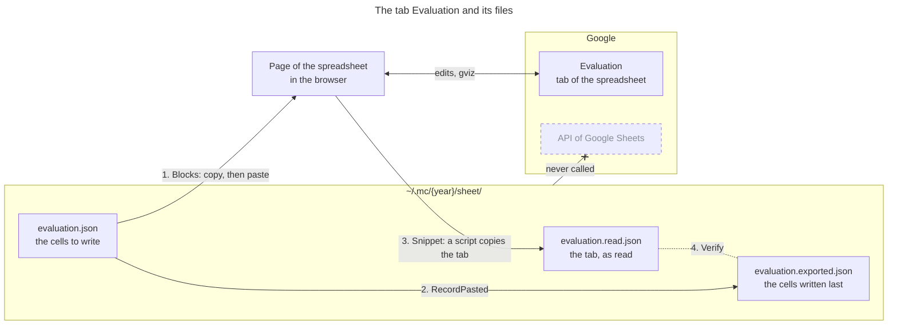

# Package `sheet`

The package `sheet` keeps the data of the tabs of a Google Spreadsheet in JSON files, and moves it
between these files and the spreadsheet. `mc` uses it for the evaluation spreadsheet of the year,
whose tab Evaluation has one row per team, lab and rule. The commands are those of `mc sheet`,
described in the section [Sheet](../README.md#sheet) of the README: this page explains the package
behind them.

## Why Not the API of Google Sheets

The package never calls the API of Google Sheets. The API needs a project of Google Cloud, an OAuth
client, and a token of the teacher's Google account kept on the machine, for one spreadsheet that
is written a few times per lab. The browser needs none of it, since the teacher is signed in to
Google there. So the teacher, or an agent in the browser such as Claude in Chrome, carries the
data between the files and the page of the spreadsheet, through the clipboard. The package prepares
what to paste, and checks what was read: `mc` holds no credential of Google.

## How the Data Moves

Each tab has 3 files in `~/.mc/{year}/sheet/`, named after the tab. Here are those of the tab
Evaluation, and the steps that move the data between them and the spreadsheet:



1. **Write.** `Blocks` splits the cells of `evaluation.json` into blocks: rectangles of adjacent
   cells, every one of them written. A block goes to the clipboard as tab-separated values, and a
   paste at its range spreads it on the cells of the tab.
2. **Record.** `RecordPasted` moves the cells of the blocks pasted from `evaluation.json` to
   `evaluation.exported.json`, the last export. The cells of a block not pasted wait still.
3. **Read.** `Snippet` writes a script to run in the page of the spreadsheet. The script reads the
   tab with gviz, the query language of Google Visualization, which answers the page with the
   session of the browser. Then it copies the rows to the clipboard, in the format of the files,
   to save as `evaluation.read.json`.
4. **Verify.** `Verify` compares the tab, as read, with the last export: a header renamed, a row
   moved or deleted, and a cell whose value is no longer the one written, such as a completeness
   that the teacher changed by hand.

The read and the export serve the next write too. A cell of the tab that differs from the export
was changed by someone else, so the tool that writes `evaluation.json` marks it with `_check`: its
block comes last, for the teacher to look at before pasting it.

## A File

A file holds one tab: one object per row, like the documents of a collection in MongoDB, whose
attributes are the columns, named by their headers. Here is a row with a made-up team:

```json
{"_row": 82, "Team": "teal", "Lab": "L2", "Rule": "L2_FBP", "Completeness": 0.9,
 "_check": {"Completeness": "0.7 at the last export"}}
```

The keys of the file, Team, Lab and Rule, find the row, and `_row` is its number in the tab. The
other attributes are the cells to write, and `_check` says why to look at a cell first. The section
[Sheet](../README.md#sheet) of the README shows a whole file.

## What Keeps the Tab Safe

**A paste never clears a cell.** A row holds the cells to write only: an attribute absent is a cell
left alone. A block has no hole, since the paste of an empty cell clears it, and `Load` refuses an
empty text for the same reason.

**A text stays a text.** Sheets reads a pasted text as if it was typed, so the commit `2e88112`
would become a number. `pasteText` starts such a text with an apostrophe, which Sheets keeps out of
the value.

**The script reads the columns of the file only.** A column out of `columns`, such as one of
personal data, never leaves the spreadsheet.

**A formula is never compared.** The tab gives the result of a formula, not the formula itself:
`Verify` skips it.

## Limits

**The number of a row comes from the last read.** If the teacher inserts or sorts rows, read the
tab again before a paste: `Verify` reports a row moved, but a block is pasted at its range.

**gviz types a column by the majority of its values.** A value of another type, such as a text in
a column of numbers, comes back empty, and `Verify` reports it as a difference.

## Code

The files of the package:

| File | What it holds |
|---|---|
| `file.go` | `File` and `Row`, `Load` and `Save`, the checks of `Problems`, and the JSON of a file |
| `blocks.go` | `Block` and `Blocks`, the rectangles of cells to paste |
| `export.go` | `RecordPasted` and `Verify`, the last export and the check of the tab against it |
| `snippet.go`, `snippet.js` | `Snippet`, the script that reads a tab in the browser |
| `value.go` | The text to paste for a value, and the comparison of a value read with the one written |
| `column.go` | The letters of a column and the A1 notation of a cell, such as `G82` |

The package imports no other package of `mc`, and its tests use made-up teams only.
